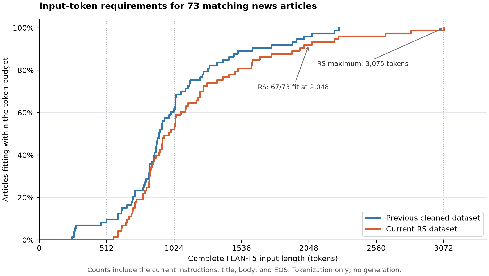

# RS news input-token analysis

Created: 2026-11-01T08:51:34.690621+00:00

All three datasets contain the same 73 unique URLs. Titles were verified equal across the three datasets after the metadata repair; records were matched by URL. Counts therefore compare body changes with the title held constant.

## Measurement

Tokenizer: `google/flan-t5-base`, cached revision `7bcac572ce56db69c1ea7c8af255c5d7c9672fc2`, class `T5Tokenizer`. Local cache only; no model weights, inference, or network requests.

The exact current pipeline input was measured: `SUMMARY_PROMPT.format(article_text=f"{title}. {full_body}".strip())`, including special tokens (one EOS). Internal whitespace and body headlines were preserved. Complete strings were tokenized directly; component token counts were not added together.

Current default: **512 input tokens**. The prompt with an empty article contains **185 tokens**; that is an illustrative overhead count, not an additive formula for every article.

## Complete input lengths

| Dataset | Minimum | Mean | Median | P95 nearest rank | Maximum | Total |
|---|---:|---:|---:|---:|---:|---:|
| Previous cleaned baseline | 251 | 1,012.7 | 911 | 2,011 | 2,278 | 73,928 |
| Recovered original | 251 | 1,057.7 | 964 | 2,064 | 2,331 | 77,214 |
| Current RS | 563 | 1,165.9 | 987 | 2,272 | 3,075 | 85,112 |

RS body-only token counts (excluding instructions, the separately supplied title, and EOS): minimum 355; mean 961.3; median 786; maximum 2,874.

## Articles fitting without truncation

| Input limit | Previous cleaned | Recovered original | Current RS | RS truncated | RS coverage |
|---:|---:|---:|---:|---:|---:|
| 512 | 7/73 | 6/73 | 0/73 | 73 | 0.0% |
| 1,024 | 45/73 | 42/73 | 38/73 | 35 | 52.1% |
| 1,536 | 65/73 | 64/73 | 59/73 | 14 | 80.8% |
| 2,048 | 70/73 | 69/73 | 67/73 | 6 | 91.8% |
| 2,560 | 73/73 | 73/73 | 70/73 | 3 | 95.9% |
| 3,072 | 73/73 | 73/73 | 72/73 | 1 | 98.6% |
| 3,200 | 73/73 | 73/73 | 73/73 | 0 | 100.0% |
| 4,096 | 73/73 | 73/73 | 73/73 | 0 | 100.0% |

## Interpretation

- The saved RS bodies were already produced by the pruned experiment. Integrating pruning into the original scheduler did not regenerate this JSON. Its bodies still match the backup taken before metadata repair.

- Compared with raw recovered data, 57 RS inputs are shorter and 16 longer; the total grows by 7,898 tokens (+10.23%). Compared with the previously cleaned snapshot, 10 are shorter, 42 have the same token count, and 21 are longer; the total grows by 11,184 tokens (+15.13%).

- These snapshots were scraped on different dates. The differences combine removal of unrelated sections, previously missing article text, expanded live updates, and publisher revisions. They are not a controlled estimate of pruning alone.

- The previous cleaned input-limit experiment is reproducible: 66/73 truncated at 512, 28 at 1,024, 3 at 2,048, and 0 at 3,072. Current RS truncation counts are 73, 35, 6, and 1 respectively.

- At 2,048 tokens, 67/73 current inputs fit (91.8%). At 3,072, 72/73 fit (98.6%); the longest input exceeds that limit by only 3 tokens. An input ceiling of 3,075 is the exact measured minimum that fits all 73; 3,200 offers a small round-number margin for this fixed dataset.

- For the longest input, truncation at 3,072 removes the final article period and the trailing `Summary:` prompt cue. All article words remain; the full formatted prompt is still truncated.

- This analysis does not select the best summarization configuration: token coverage alone does not measure summary quality, inference speed, or memory use. No model input limits or generation settings were changed.

## Longest RS inputs

| Source position | Title | Complete input tokens |
|---:|---|---:|
| 29 | Live updates: Bitcoin edges higher as U.S. stocks rebound early Monday | 3,075 |
| 51 | Live updates: Bitcoin clings to $82,500 as SpaceX results lift stock futures | 2,825 |
| 59 | Live updates: Bitcoin’s round trip to $85,000 burns traders on both sides | 2,632 |
| 10 | Live updates: Bitcoin dips to $81,000 as stocks slide, VIX soars ahead of Black Monday anniversary | 2,272 |
| 61 | Crypto for Advisors: Stablecoins are ready for prime time | 2,244 |
| 53 | OCC's final rule to start fresh in weighing stablecoin rewards against GENIUS Act ban | 2,071 |
| 54 | Crypto Long & Short: Why real-world assets need fixed-rate loans onchain | 2,011 |
| 37 | Live updates: Market jitters persist as the AI selloff deepens | 1,980 |
| 43 | The Coinbase allegations expose Bitcoin's corporate governance gap | 1,921 |
| 3 | ‘Wow, it’s a real discovery’: Claude cracks a 25-year NSA number mystery | 1,766 |

## Traceability

- `per_article_comparison.csv`: all 73 URL-matched records, counts, deltas, and primary truncation flags.
- `rs_pruned_tokens.csv`, `recovered_original_tokens.csv`, and `previous_cleaned_tokens.csv`: complete per-dataset measurements and budget checks.
- `token_report.json`: exact statistics, tokenizer/prompt versions, SHA256 hashes, source paths, and a 3,072-token tail audit for the longest input.
- `prompt_template.txt`: exact prompt used.

Original datasets and FLAN settings were read only.
