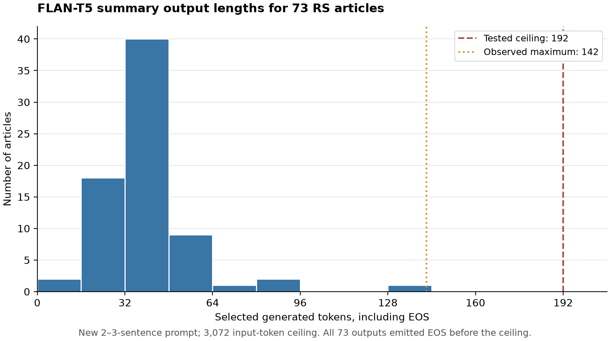

# FLAN-T5 summary output lengths on current RS articles

Completed 01 November 2026, 19:55:14 (Asia/Jakarta). This is an output-length experiment using the user's new 2–3-sentence prompt, not a ROUGE/BERTScore evaluation.

**All 73 summaries finished naturally before the 192-token ceiling.** There were no generation errors, no input truncation, and no higher-ceiling reruns. The longest selected output used **142 generated tokens**, including EOS and any other generated special tokens; its visible-content count was **140 tokens**.

## Token lengths

| Measure | Generated tokens, including EOS | Content tokens, excluding special tokens |
|---|---:|---:|
| Minimum | 13 | 12 |
| Mean | 40.45 | 39.44 |
| Median | 38 | 37 |
| 90th percentile, nearest rank | 51 | 50 |
| 95th percentile, nearest rank | 70 | 69 |
| Maximum | 142 | 140 |

The generated-token column is the relevant measurement for `max_new_tokens`. It excludes the decoder-start token and beam-buffer padding, and includes the EOS end marker. Content counts exclude all special tokens; they are not assumed to equal generated counts minus one for every summary.

## Lengths relative to smaller ceilings

This table counts the lengths observed in the **192-token run**. It is not the result of generating again at the smaller ceilings.

| Candidate ceiling | Observed outputs with length at or below it | Observed outputs longer than it |
|---:|---:|---:|
| 64 | 69/73 | 4 |
| 96 | 72/73 | 1 |
| 128 | 72/73 | 1 |
| 160 | 73/73 | 0 |
| 192 | 73/73 | 0 |

An output ceiling of 128 would not accommodate the 142-token output observed here. A ceiling of 160 is above every output length observed in this run, while 192 directly demonstrated natural completion in all 73 cases. These observations do not prove that 160 is the minimum safe ceiling: beam-search selection can change when the ceiling changes.

## Longest output

- Source record: **#37**.
- Title: **Live updates: Market jitters persist as the AI selloff deepens**.
- Dataset article ID: `6d7c5ee00eafae06726b0c9e00d56827425f044d1df8758e63b1d57f9cc3c435`.
- RSS GUID: `efc80dd3-7bb2-4634-b4a2-7d7a1587e453`.
- Generated tokens: **142**; content tokens: **140**.
- Stop reason: `eos_before_limit`.

> Output: Live updates: Market jitters persist as the AI selloff deepens. Elon Musk’s SpaceX SPCX$134.71Market Closed reported third-quarter revenue of $14.58 billion (up 161% year-over-year), topping estimates for $12.87 billion. Adjusted EBITDA of $8.81 billion was ahead of forecasts for $6.59 billion. Net income of $4.4 billion topped expectations for $1.88 billion. Amazon storing billions in Nvidia hardware in warehouses It turns out that data center power generation and buildouts are lagging well behind hardware in the AI race. [...]

## What natural completion establishes

EOS before the ceiling shows that the selected model output stopped before its token allowance ran out. It does not establish factual correctness, readability, or compliance with the requested sentence count.

Three concrete spot checks illustrate the distinction:

- Record #1 ends naturally after one sentence, despite the instruction to write 2–3.
- Record #28 ends naturally at 93 generated tokens but copies newsletter/signup material and ends its explanation with `200-day...`. That issue is in the selected summary even though the output was not capped.
- The longest output, record #37, includes an `Output:` prefix and ends with `[...]`. Its naturally emitted EOS likewise does not make it a complete factual or editorial summary.

These are limited spot checks, not an exhaustive factuality or sentence-compliance score. No minimum output length, forced sentence count, or post-generation rewriting was added.

## Fixed protocol

- Model: `google/flan-t5-base`, cached revision `7bcac572ce56db69c1ea7c8af255c5d7c9672fc2`; local cache only.
- Exact prompt saved in `prompt_template.txt`; SHA256 `5316074c4b48efe08125f99b2d8fde09d56c9c37b31481314b3880b57ea559ce`.
- Article input: the current RS title followed by `. ` and the unmodified full body. Original article IDs were mapped by URL.
- Input ceiling: **3,072 tokens**. Complete inputs ranged from **493** to **3,005** tokens, including instructions, title, body and EOS. None was truncated.
- Initial output ceiling: **192 new tokens**. The runner would retry capped or ambiguous outputs at 256, 384, then 512; no retries were required.
- Generation: `do_sample=False`, `num_beams=4`, `early_stopping=True`, `no_repeat_ngram_size=3`. No forced EOS.
- Execution: CPU float32, 4 threads, seed 0; Torch 2.13.0, Transformers 5.14.1.
- Started 19:50:23; finished 19:55:14 on 01 November 2026, Asia/Jakarta. Recorded elapsed time: **291.30 seconds** (4.86 minutes), including setup and checkpoints. This is not a controlled latency benchmark.
- Every generation was checkpointed and audited using selected-sequence beam ancestry. This avoids counting decoder-start or beam-padding tokens as summary output.
- Source integrity checks passed. Current RS articles, GPT reference files, prior results, and production model settings were not rewritten.

## Files

- `summaries_and_lengths.csv`: all 73 summaries and their per-article token counts, IDs and stopping reasons.
- `summaries.json`: final selected results, including selected token IDs and detailed stopping evidence.
- `generation_metrics.json`: every generation attempt; 73 attempts in this run.
- `selected_articles.json`: frozen current inputs with stable IDs, exact article text and input token counts.
- `run_report.json`: configuration, source/prompt hashes, timing, status and aggregate measurements.
- `prompt_template.txt`: the exact new prompt.
- `output_token_distribution.png` and `.svg`: the distribution figure, counting generated tokens including EOS.

No reference summaries were needed for this output-length measurement. ROUGE, BERTScore, lower-ceiling generation tests, and exhaustive factuality review were not performed.
