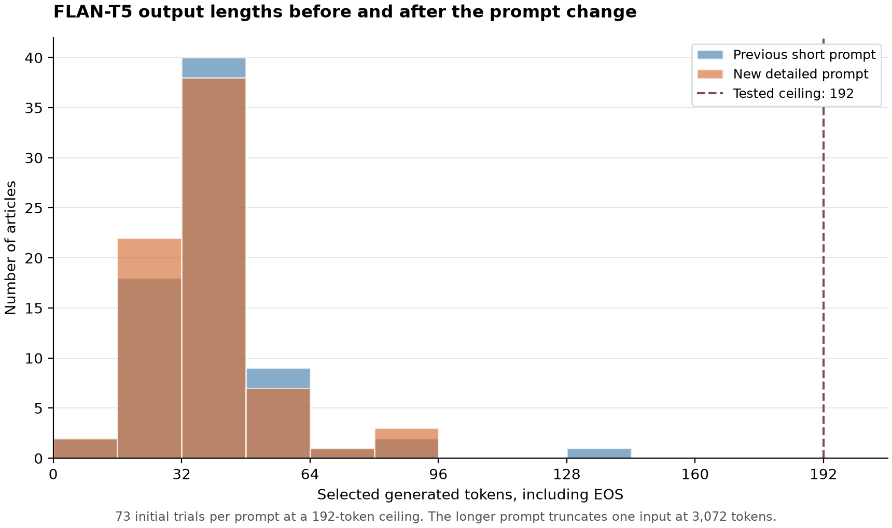

# FLAN-T5 detailed-prompt output-length experiment

Completed 01 November 2026, 20:09:44 (Asia/Jakarta). The new prompt contains eight beginner-focused guidelines. The same 73 current RS articles, model, and decoding settings were used as in the preceding short-prompt run.

**All 73 outputs emitted EOS naturally before 192 tokens.** There were no generation errors or higher-ceiling reruns. The longest selected new output used **93 generated tokens including EOS**, with 92 content tokens. This is an output-length experiment; no ROUGE or BERTScore was computed.

## Paired output lengths at the same 192-token ceiling

| Measure | Previous short prompt | New detailed prompt |
|---|---:|---:|
| Minimum | 13 | 13 |
| Mean | 40.45 | 38.52 |
| Median | 38 | 36 |
| 90th percentile, nearest rank | 51 | 51 |
| 95th percentile, nearest rank | 70 | 79 |
| Maximum | 142 | 93 |

Counts above include EOS and any other generated special tokens; they exclude decoder-start and beam-buffer padding. These are the counts relevant to `max_new_tokens`. New visible-content token counts, excluding all special tokens: minimum 12, mean 37.51, median 35, p90 50, p95 78, maximum 92.

Across all 73 articles, **18 summaries changed** and **55 stayed identical**. Outputs became shorter for 12 articles, longer for 6, and kept the same generated-token length for 55.

The mean and maximum decreased, but the 95th percentile increased from 70 to 79. The detailed prompt therefore did not make every output shorter. Length changes alone do not show better factual accuracy, simplicity, or overall summary quality.

## Input truncation and the 72-article comparison

The longer prompt adds **261 complete input tokens per article**. New complete inputs range from **754 to 3,266** tokens. The previous maximum was 3,005.

At the fixed 3,072-token input ceiling, **72 articles remain untruncated; record #29 loses 194 input tokens** (3,266 complete versus 3,072 consumed). The exact input-truncation evidence is preserved in `run_report.json` and `generation_metrics.json`.

Record #29 is **Live updates: Bitcoin edges higher as U.S. stocks rebound early Monday**, ID `7037e738fd040b42bb3a806bd3066c59a904f30a4dc1247d8f67fea1bcc024c0`. Its previous/new output lengths are 20/20 generated tokens. Its summary remained identical despite the input truncation; its model inputs differ in both prompt and available article text.

Among the **72 articles with untruncated inputs in both runs**, 18 summaries changed and 54 stayed identical. Their mean generated length changed from 40.74 to 38.78. Outputs were shorter/same/longer for 12/54/6 articles.

## Longest new output

- Source record: **#28**.
- Title: **Strategy's price chart is about to flash a major bullish signal weeks after bitcoin did**.
- Dataset ID: `d3e9bcc0baa595381ffce6ea8a1db48861951719f8d8a13208c75c8e2cf624cf`.
- RSS GUID: `972d03a3-d2aa-4790-97c3-aa482a5244f0`.
- Generated tokens: **93**; content tokens: **92**.
- Stop reason: `eos_before_limit`.

> Your day-ahead look for Oct. 19, 2026 This is an excerpt from CoinDesk newsletter 'Daybook.' Sign up here, if you haven't already. Weeks after bitcoin's (BTC) price chart flashed a major bullish signal, Strategy The signal, a golden cross, occurs when a security's 50-day average price rises above its 200-day...

## Observed lengths relative to smaller ceilings

| Candidate ceiling | New outputs with observed length at or below it | New outputs longer than it |
|---:|---:|---:|
| 64 | 69/73 | 4 |
| 96 | 73/73 | 0 |
| 128 | 73/73 | 0 |
| 160 | 73/73 | 0 |
| 192 | 73/73 | 0 |

These are observations from the 192-token run, not actual lower-ceiling tests. Although all new outputs are shorter than 96 tokens, this does not prove identical summaries or natural completion under a fresh 96-token configuration; changing a ceiling can change beam selection.

## Limited format spot checks

- Record #1 is still the same one-sentence summary as before, despite both prompts requesting 2–3 sentences.
- Record #3 changes from two sentences to one; record #5 becomes a short headline-style sentence. These are output-selection observations, not factuality scores.
- The longest new output, record #28, still includes newsletter/signup material and ends its explanation with `200-day...` while emitting EOS naturally. A natural end marker therefore does not establish editorial completeness or prompt compliance.

These are limited checks. No exhaustive factuality, readability, or sentence-count scoring was performed, and no minimum output length or post-generation rewriting was added.

## Fixed protocol and provenance

- Model: `google/flan-t5-base`, revision `7bcac572ce56db69c1ea7c8af255c5d7c9672fc2`, local cached weights only.
- Same 73 IDs, titles, URLs, full bodies, and row order verified across frozen snapshots. Both initial trials use input 3,072 and output 192.
- New prompt source: `prompts/flan_beginner_detailed_20261101.txt`; exact run copy: `prompt_template.txt`.
- Previous prompt SHA256: `5316074c4b48efe08125f99b2d8fde09d56c9c37b31481314b3880b57ea559ce`; new SHA256: `f8a534a627fd2bf50b12f34a3f8ecefa08391bdbd018d55f2ac6a2fc734e442a`.
- Decoding: `do_sample=False`, `num_beams=4`, `early_stopping=True`, `no_repeat_ngram_size=3`; no forced EOS.
- CPU float32, four threads, seed 0; Torch 2.13.0, Transformers 5.14.1.
- Only capped/ambiguous outputs would be retried at 256, 384, 512. All initial outputs finished naturally, so final results equal the initial 192-token trials.
- Started 20:04:52; finished 20:09:44 on 01 November 2026, Asia/Jakarta. Recorded elapsed time: **292.14 seconds** (4.87 minutes), including setup and checkpoints. This is not a controlled latency benchmark.
- Input/source integrity checks passed. Prior run files, article sources, reference summaries, and production model settings were not rewritten.

## Files

- `summaries_and_lengths.csv` and `summaries.json`: all 73 final outputs, IDs, lengths, and stop reasons.
- `generation_metrics.json`: every generation attempt and selected-token audit.
- `run_report.json`: generation settings, source/prompt hashes, input truncation, timing and aggregate measurements.
- `selected_articles.json` and `prompt_template.txt`: exact frozen articles and new prompt.
- `prompt_comparison.csv`: 73 ID-matched old/new initial 192-token outputs, token deltas, input flags, and new final results.
- `prompt_comparison.json`: old/new statistics, same-configuration checks, all 73 and untruncated 72 comparisons, and the affected record #29.
- `output_token_distribution.png` and `.svg`: initial 192-token output distributions for the two prompts.

No GPT references, ROUGE/BERTScore evaluation, smaller-ceiling generations, or production setting changes were performed.
